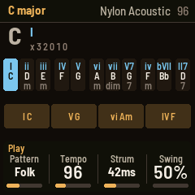
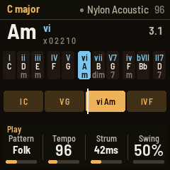
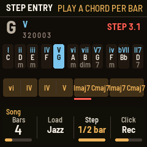

# STRUMLINE for the M-VAVE FM-1

A strummed guitar with a bass player. Pick a key and the **black keys** become its chords, already shaped
for the guitar. Pick a pattern and it strums them, with a bass under it. Put chords in the **song loop**
and PLAY plays the whole progression, hands free. You don't need to know any guitar.

Strumline is a fork of [Guitchordi](https://github.com/stoogs/guitchordi) by stoogs (its sixteen string
instruments, on Clipper's PHYS string model), with [Bassline](https://github.com/mighty-stack444/bassline-fm1)'s
bass and a simpler, key-based way to play. It runs on the community FM-1 platform
([Felucca](https://github.com/hugelton/Felucca), by way of [X0X](https://github.com/charlesvestal/fm1-x0x)
and [FoMni](https://github.com/charlesvestal/fm1-fomni)): the hardware layer, USB, storage, safe mode and
the installer are theirs.

> **Status: new.** It builds and passes every test in the simulator (the whole app, UI and sound, on a
> computer) and in the browser emulator. See "Safety" before installing.

  

## Three steps to a song

1. **Pick a key** with PRESETS (twelve majors, twelve minors). The black keys are now that key's chords,
   and the screen names each one: C, Dm, Em… with its numeral.
2. **Make a progression.** On the Song page (SEQ), KNOB 2 loads a ready one: Pop, 50s, Sad, Rock,
   Jazz ii-V-I, Canon, Blues 12 bar, Epic, Andalusian. Or press **REC** and play chord keys: each fills the
   next half bar (or bar); LFO keeps the chord going.
3. **PLAY.** The loop plays your progression with the pattern and the bass. Change the key and the whole
   song moves with it.

## The controls

| Control | What it does |
| --- | --- |
| **Black keys** | The key's chords: I ii iii IV V vi vii°, then V7, iv, ♭VII, II7 (minor keys: i ii° III iv v VI VII, then V, V7, IV, ♭II). Each one's guitar shape is worked out for the key and the tuning |
| **ENV** | Held with a chord key: its 7th (maj7 where the chord has a major 7th) |
| **White keys** | The chord's six strings, low to high, three times over: soft, normal, accent |
| **ARP** | The strum pattern on / off. Hold a chord and it strums; the bass plays under it |
| **PLAY** | The song loop. A chord key held while it plays takes over until you let go |
| **REC** | Playing: record chord changes into the loop. Stopped: step entry (SELECT moves the cursor; PLAY from there records live after a count-in) |
| **LFO** | Undo, then redo. Held 1.5 s: clear the song. In step entry: "keep the chord" |
| **OCT− / OCT+** | The shapes an octave down / up |
| **SELECT** · **ALGORITHM** · **PRESETS** | Tempo · instrument · key |
| **KNOB 1–4** | The four values on the screen |
| **SAVE** | Saves the song and settings (it also saves by itself, when quiet) |

## The pages

HOME, FX, SEL, SEQ and GLO each open a page; EDIT steps through them.

| Page | KNOB 1 | KNOB 2 | KNOB 3 | KNOB 4 |
| --- | --- | --- | --- | --- |
| **Play** (HOME) | Pattern | Tempo | Strum (pick sweep speed) | Swing |
| **Sound** (FX) | Instrument | Tone | Room (plate reverb) | Level |
| **Bass** (SEL) | Bass pattern | Bass sound | Bass volume | Bass tone |
| **Song** (SEQ) | Bars (1–12) | Load a progression | Step (half bar / bar) | Click |
| **Setup** (GLO) | Tuning | Count-in | Lights | Octave |

- **Patterns:** Off, Block, Down 4s, Down 8s, Down-Up, Folk, Rock, Ballad, Reggae, Ska, Boom-chick, Travis, Arp, Arp 16s.
- **Instruments:** Wood, Wire, Glow, Nylon / Steel / Jumbo acoustic, Palm muted, Clean electric, Round jazz, Crunch, Heavy, Harp, Violin, Pizzicato cello, Electric bass, Dulcimer.
- **Bass patterns:** Off, Follow (with the strum), Root 4s, Root 8s, Root-5th, Octaves, Walk, Pump.
- **Bass sounds** (Bassline's): 808, Finger, Pick, Slap, Muted, Fretless, Upright, Acid, Sub, Reese.
- **Tunings:** Standard, Drop D, Open G, Open D, DADGAD, Half down.

MIDI in (USB or the TRS jack): a note on channel 1 picks the key's chord on that root.

### What changed from Guitchordi

- Chords come from the **key**, not from guitar positions: one knob picks the key and the eleven chord
  keys are always the chords that belong in it, named on screen.
- The **lock** is replaced by the **song loop**: 1–12 bars, a chord per half bar, recorded live or step by
  step, or loaded from a preset. PLAY plays it hands free.
- One **pattern** list instead of separate strum and rhythm settings.
- A **bass** under the chords, from Bassline.
- A plainer screen: the chord, its numeral and shape, the eleven chord keys, the song strip.
- **CPU guard:** if the audio load passes 85 %, fewer string voices sound at once (down to 6); they come
  back when it drops.

## Try it first, in the browser

`web/emu/` builds the whole firmware for the browser (the same C code, with sound). The GitHub build
publishes it, or build it yourself (`web/emu/build.sh`).

## Build and install

1. Put this folder in a GitHub repository (it contains `.github/workflows/build.yml`).
2. In the repository: **Settings › Pages › Source: GitHub Actions**.
3. Push (or **Actions › build › Run workflow**). It builds the firmware, runs the tests and publishes a site
   with the emulator, the web installer and the `.fwsc` download.
4. Open the site's **Install** page in Chrome or Edge with the FM-1 connected by USB (on Android, Chrome
   with a USB-OTG cable).

The version is in the `VERSION` file. Locally: see [BUILDING.md](BUILDING.md) (`./build.sh`, then
`python3 tools/fm1_install.py build/strumline.fwsc`).

## Safety

Installing custom firmware is at your own risk. The installer can put M-VAVE's own firmware back; after
two failed starts Strumline stays in a safe mode with USB on so the installer can still reach it; holding
OCT− and OCT+ for 5 seconds enters update mode; and `tools/fm1_rescue.sh` /
[FM-1-transporter](https://github.com/kurogedelic/FM-1-transporter) cover the chip's own update mode.
M-VAVE's M-UPGRADE also restores the stock firmware.

## Tests

`tests/run_tests.sh` runs the platform tests and the whole app in the simulator:
`tests/scenarios/strum.omni` (shapes, plucks, patterns and bass, the 7th, key changes, the song loop,
presets, undo, step entry, live recording, tunings, saving). Screenshots and audio land in `build/scenarios/`.

## Licence

GPL-3.0-only. The string model (`firmware/src/dsp/gtr/phys_dsp.c`) is MIT. See [LICENSING.md](LICENSING.md).
